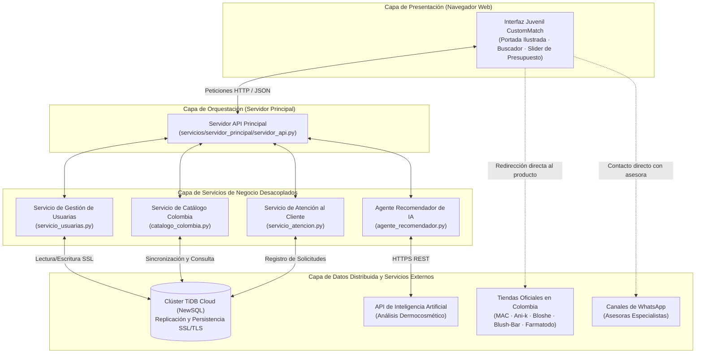

# PORTADA

**TÍTULO DEL PROYECTO:**  
**CustomMatch: Plataforma Distribuida de Recomendación de Maquillaje, Análisis de Perfil Cutáneo y Atención Personalizada**

**ASIGNATURA:**  
Sistemas Distribuidos

**ACTIVIDAD:**  
Organización del Modelo y Diseño de la Solución bajo las Herramientas y Elementos Identificados

**INTEGRANTES DEL EQUIPO DE TRABAJO:**  
- [Nombre del Estudiante 1]  
- [Nombre del Estudiante 2]  
- [Nombre del Estudiante 3]  

**DOCENTE:**  
[Nombre del Docente]

**INSTITUCIÓN / UNIVERSIDAD:**  
[Nombre de la Institución] — Facultad de Ingeniería

**CIUDAD Y FECHA:**  
Colombia, Noviembre de 2026

---

# 1. INTRODUCCIÓN DE LA ACTIVIDAD

En la actualidad, las personas tienen dificultad para encontrar productos de maquillaje adecuados a sus características y presupuesto, debido a que deben consultar diferentes fuentes para conocer qué productos les pueden servir y dónde encontrarlos a un precio conveniente. La información sobre maquillaje se encuentra dispersa entre tiendas, marcas y diferentes fuentes. Una persona puede necesitar conocer su tipo de piel, tono, subtono y presupuesto, además de comparar precios y disponibilidad. Según un estudio de Estée Lauder citado por Luna (2017), el **77% de las mujeres usa un tono de base de maquillaje incorrecto**, lo que evidencia que el problema de encontrar el producto adecuado es generalizado. La plataforma busca reunir esta información en un solo sistema y facilitar la decisión de compra.

Actualmente, una persona puede buscar recomendaciones en redes sociales, páginas web y tiendas en línea, y debe consultar diferentes productos de forma manual, comparando por separado precios, disponibilidad y características de cada uno. El problema no está resuelto porque esta información se encuentra distribuida entre distintas fuentes que no se comunican entre sí, y porque las recomendaciones dependen de las características particulares de cada persona y de su presupuesto, lo cual dificulta ofrecer una respuesta única y centralizada.

### Caso de Uso Ilustrativo: Laura
Laura quiere comprar maquillaje para asistir a un evento. No sabe con certeza qué productos son adecuados para su tipo de piel, tono y subtono. Además, tiene un presupuesto limitado y debe revisar diferentes tiendas para encontrar productos que pueda comprar. La plataforma **CustomMatch** le permite registrar sus características una sola vez y ajustar su presupuesto en cada búsqueda para recibir recomendaciones personalizadas, conocer el tono sugerido para ella y dirigirse directamente al producto en la tienda elegida.

---

# 2. RECONOCIMIENTO DE LO QUE NECESITARÍA LA SOLUCIÓN (ELEMENTOS Y HERRAMIENTAS IDENTIFICADAS)

Para resolver la dispersión de información y atender el caso de uso de Laura bajo los elementos vistos en los talleres anteriores, se identificó que la solución **CustomMatch** necesita los siguientes componentes funcionales, de seguridad y de arquitectura distribuida:

1. **Explicación Inicial e Incorporación Guiada:** Una vista de bienvenida intuitiva e ilustrada que explique qué hace la plataforma en tres pasos antes de iniciar el cuestionario o mostrar el catálogo.
2. **Persistencia del Perfil Cutáneo en Base de Datos Distribuida:** Un sistema de cuentas que almacene en la nube el **tipo de piel** (seca, mixta, grasa o normal), **tono** (clara, media, bronceada o profunda), **subtono** (oliva, cálido, frío o neutro) y **condiciones de cuidado** (acné, sensibilidad, rojeces o poros) para que, al iniciar sesión nuevamente, la usuaria no tenga que volver a responder las preguntas.
3. **Motor de Inteligencia Artificial para Diagnóstico y Recomendación:** Conexión a una API de IA acompañada de reglas dermocosméticas para evaluar qué fórmulas y tonos se adaptan mejor a las características registradas por la usuaria.
4. **Buscador con Filtro Dinámico de Presupuesto (`$ COP`):** Dado que el presupuesto varía en cada ocasión de compra, el sistema necesita permitir que la usuaria busque productos específicos (como una *base*, un *corrector* o un *rubor*) y ajuste en tiempo real el precio máximo que desea gastar.
5. **Catálogo Unificado con Redirección Directa al Producto:** Integración de productos de distintas tiendas y marcas disponibles en el país (**MAC Cosmetics, Ani-k Makeup, Bloshe/Montoc, Blush-Bar y Farmatodo**), mostrando su imagen, el tono exacto sugerido, su precio y un enlace directo a la página específica del producto para comprarlo.
6. **Servicio de Atención Personalizada al Cliente:** Un módulo de acompañamiento con especialistas en cuidado de la piel, elección de tonos y compras, conectado mediante botones directos a WhatsApp para resolver dudas puntuales.
7. **Seguridad y Protección de Datos:** Manejo de credenciales mediante variables de entorno aisladas (`.env` protegido por `.gitignore`), contraseñas encriptadas con hash `SHA-256`, consultas SQL parametrizadas contra inyección SQL, conexión cifrada mediante `SSL/TLS` hacia la base de datos distribuida y cabeceras de seguridad HTTP (`X-Content-Type-Options`, `X-Frame-Options`, `Referrer-Policy`).

---

# 3. DISEÑO Y MODELO PROPUESTO DE LA SOLUCIÓN BAJO LOS ELEMENTOS VISTOS

El diseño de **CustomMatch** se organiza bajo una **Arquitectura Orientada a Servicios (Microservicios Modulares en Python)** comunicados mediante peticiones HTTP/JSON a través de un servidor orquestador central y respaldados por una base de datos distribuida en la nube (**TiDB Cloud**).

### 3.1. Estructura de Servicios del Sistema
- **`conexion_tidb.py` (`servicios/base_de_datos/`):** Gestiona la conexión distribuida hacia **TiDB Cloud** mediante SSL/TLS y aplica tolerancia a fallos mediante respaldo local automático en caso de desconexión de red.
- **`servicio_usuarias.py` (`servicios/gestion_usuarias/`):** Administra el registro e inicio de sesión de las usuarias, guardando y recuperando su perfil de piel desde las tablas `registered_users` y `user_skin_profiles`.
- **`agente_recomendador.py` (`servicios/inteligencia_artificial/`):** Procesa las respuestas del cuestionario cutáneo a través de la API de IA para determinar las fórmulas cosméticas ideales para la usuaria.
- **`catalogo_colombia.py` (`servicios/catalogo_maquillaje/`):** Centraliza los productos de las distintas tiendas, filtra en tiempo real por compatibilidad cutánea y presupuesto máximo (`price_cop <= max_price_cop`), y calcula el tono exacto sugerido para la usuaria.
- **`servicio_atencion.py` (`servicios/atencion_cliente/`):** Gestiona el directorio de asesoras de belleza y los canales directos de atención por WhatsApp, además del registro de solicitudes en la tabla `solicitudes_atencion_cliente`.
- **`servidor_api.py` (`servicios/servidor_principal/`):** Actúa como puerta de enlace (*API Gateway*) que coordina la interfaz web (`interfaz_web/`) con cada uno de los servicios anteriores.

### 3.2. Modelo de Base de Datos Relacional Distribuido (`base_de_datos_sql/crear_tablas_tidb.sql`)
1. **`registered_users`**: Datos de cuenta de la usuaria (`user_id`, `full_name`, `email`, `city_colombia`, `password_hash`).
2. **`user_skin_profiles`**: Características de piel guardadas (`user_id`, `skin_type`, `skin_tone`, `undertone`, `conditions_json`, `last_max_price_cop`, `ai_skin_summary`).
3. **`colombia_virtual_stores`**: Tiendas registradas y cobertura de envío.
4. **`makeup_products_colombia`**: Productos centralizados con precio, atributos de piel compatibles, imagen y URL directa al producto (`store_url`).
5. **`solicitudes_atencion_cliente`**: Historial de solicitudes de asesoría personalizada.

---

# 4. REFERENCIAS
- Luna, C. (2017). *Estudio de Estée Lauder sobre la elección del tono de base de maquillaje en mujeres*.
- PingCAP. (2026). *TiDB Cloud Serverless Architecture & Distributed SQL Documentation*.
- Tanenbaum, A. S., & Van Steen, M. (2017). *Distributed Systems: Principles and Paradigms* (3rd ed.).
